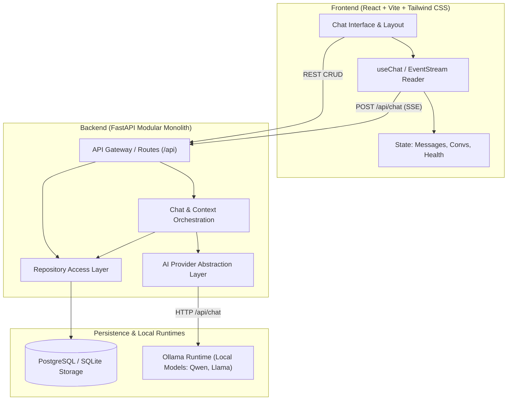

# AUREVON AI — System Architecture

## 1. Architectural Philosophy

AUREVON AI is designed as an **independent, open-source-first, multimodal AI platform**.
The core design prioritizes:
- **Modular Monolith**: Clean module boundaries without premature microservice overhead.
- **Provider Independence**: A pluggable AI provider abstraction decoupling core conversation and agent logic from any single inference engine.
- **Local-First Privacy**: Seamless support for local inference (e.g. Ollama with Qwen/Llama) with zero cloud dependency required for baseline functionality.
- **Relational Persistence**: Strict schema enforcement and relational integrity for conversations, messages, user settings, memories, and documents.

---

## 2. System Architecture Diagram

---

## 3. Core Modules

### 3.1 AI Provider Abstraction (`backend/app/services/ai/`)
- `BaseAIProvider`: Abstract interface specifying health checks, model discovery, token streaming, and synchronous completion.
- `OllamaProvider`: Concrete implementation interfacing with the local Ollama daemon (`http://127.0.0.1:11434`), supporting GGUF quantized models like `qwen2.5:3b` and `qwen3:4b`.
- `ProviderFactory`: Factory pattern resolving providers dynamically without modifying API handlers.

### 3.2 Relational Data Tier (`backend/app/models/` & `backend/app/database/`)
- Asynchronous SQLAlchemy 2.0 with connection pooling.
- Dual-driver flexibility:
  - **PostgreSQL**: Target database for multi-user production (`postgresql+asyncpg://`).
  - **SQLite**: Automatic zero-config local development (`sqlite+aiosqlite:///`).
- Entities:
  - `User`: Identity, authentication credentials, and account metadata.
  - `Conversation`: Thread containers with title, user foreign key, and ordering indexes.
  - `Message`: Conversational turns with role (`user`, `assistant`, `system`), token usage, and model tracking.
  - `UserSettings`: UI themes, preferred default models, and memory flags.
  - `Memory`: Cross-conversation facts and user preferences.
  - `Document`: Uploaded document metadata and processing stages.
  - `AgentRun`: Multi-step agent executions and tool logs.

### 3.3 Streaming Protocol
- Real-time responses use **Server-Sent Events (SSE)** (`text/event-stream`).
- Events stream as JSON payloads:
  - `{"conversation_id": "...", "user_message_id": "...", "delta": "", "done": false}`
  - `{"conversation_id": "...", "delta": "token", "done": false}`
  - `{"conversation_id": "...", "assistant_message_id": "...", "delta": "", "done": true}`
